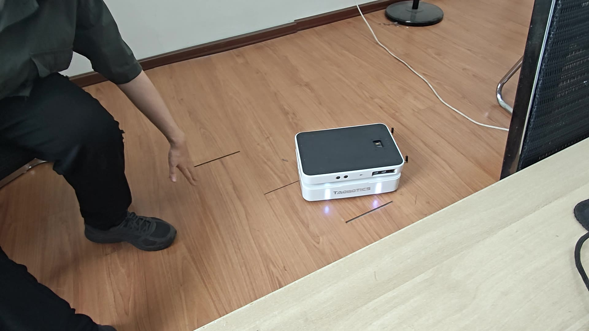

# RS：移动机器人交互与监控控制台

基于 **Taobotics Gemini 移动机器人** 的人机交互项目。仓库保留已有的手势控制演示，并以 **C++17** 逐步开发 PC/手机监控、人工遥控和设备管理能力。

当前可运行的新模块是**离线状态模型、电池与里程计时效判断、JSON 模拟状态发布程序和持续模拟/回放仪表盘**。真实传感器接入、底盘遥控与开关机按下方里程碑推进。

## 当前进度

更新日期：**2026-10-18**。

- 当前阶段：**M1 离线原型**，M1-004 已验收合并；M1-005A 回放与 M1-005B 持续模拟已通过 Windows 与 Linux 验收，已合并 PR #3；里程计核心、JSON与网页接入已通过 Windows 与 Linux 同版本验收。
- 下一项：**M1-005C，手机联机与完整属性**，继续补齐 CPU/内存/温度、日志和物理手机联网，核心模块继续按同版本验证流程交付。
- 上一轮已验收代码基线：[1ba367de2b69](https://github.com/deletervs/AMR-v-e/commit/1ba367de2b695b1dfd0b8d70e1cd542ad7a8c7ec)。Linux 同提交 **CTest 5/5、服务测试 11/11 通过**；Windows 被测源码与提交指纹一致。
- 核心当前项：**M1-005C-01，里程计状态模型**，用户核心、模拟 JSON 和网页已接通；Windows Debug 构建及 CTest 6/6、服务测试 15/15 与实际 Edge 验收通过，Linux 同提交验收也已通过，等待 PR 合并。
- M1 整体仍在进行中；目前输出均标注 `source: "mock"`，运动使能保持 `false`。

## 整体蓝图

| 阶段 | 交付目标 | 状态 |
| --- | --- | --- |
| M0 范围与方案 | 完整仪表盘、近场操控、远程查看、设备与电源的范围和接口 | 范围已约定；网络与硬件能力逐项核验 |
| **M1 离线原型** | 模拟状态 → 结构化输出 → PC/手机仪表盘，能展示未知、过期、故障与日志 | **进行中：回放与持续模拟双平台代码验收通过，手机联机和完整属性待开发** |
| M2 真实只读监控 | 接入实际电池、里程计、资源指标、相机和雷达，标明数据来源与质量 | 待开发/核验 |
| M3 离线双输入遥控 | 虚拟键位和 XSS 手柄控制假机器人，验证断联、切后台与控制权 | 待开发 |
| M4 本地真实遥控 | 机器人端命令超时、停止保护、控制仲裁和有限底盘操控 | 待接入与现场验收 |
| M5 设备与开关机 | 服务启停、主机关机/重启，以及经硬件核验的远程开机 | 待开发/能力核验 |
| M6 远程上线 | 选择 VPN 或云端方案，提供认证、远程只读监控与历史记录 | 待验证与选择 |
| M7 整体验收 | PC/手机/手柄场景、版本回退、异常处理与能力缺口检查 | 待验收 |

XSS 暂按 Xbox Series 手柄理解，具体型号、按键映射和 PC/手机连接方式仍需实测。

### M1 内部进度

| 任务 | 内容 | 状态 |
| --- | --- | --- |
| M1-001 状态模型 | `RobotState`、`BatteryState`、`DataQuality`，默认状态和可选电压 | 基础版完成 |
| M1-002 数据新鲜度 | 通用时间判断、电池读数更新与质量刷新 | 通用规则和电池接入完成 |
| M1-003 构建与测试 | CMake/CTest、Windows/Linux 同版本验证、Git/PR 流程 | 完成 |
| M1-004 模拟状态输出 | 四场景演示、持续 JSON 发布、快速测试模式及接口验收 | 完成，已合并 PR #2 |
| M1-005 模拟仪表盘 | 最小网页数据链路、PC/手机页面、扩充模拟属性和日志 | A/B：实现与双平台代码验收完成，已合并PR #3；C：里程计双平台已验收；手机联机、资源指标与日志待完成 |

当前 `RobotState` 包含连接、运动使能、电池与里程计状态；模拟 JSON 与网页均已接入里程计六个数值和独立质量。资源指标、日志和真实手机联网继续按 M1-005C 推进。

## 已实现能力与数据约定

- 电池电压用 `std::optional<double>` 表示；未收到读数时输出 JSON `null`。
- 数据质量包含 `Unknown`、`Valid`、`Stale`、`Fault`、`Unsupported`。
- 读数年龄达到超时阈值即视为过期；刷新质量时保留旧电压与接收时间。
- 连接状态与数据质量分别表示：模拟连接仍在时，电池读数也可能已经过期。
- 默认演示输出四份状态：`Unknown → Valid → Stale → Valid`。
- 持续模式每约 500 ms 发布一行，逐行刷新输出缓冲，供后续网页服务通过管道读取。
- 快速模式使用虚拟时间生成 17 份状态，无需等待真实的八秒。

输出格式为**每行一份完整 JSON 状态**，例如：

```json
{"source":"mock","sim_time_ms":3000,"connected":true,"motion_enabled":false,"battery":{"voltage_v":2.5,"quality":"Stale"},"odometry":{"reading":{"x_m":0,"y_m":0,"yaw_rad":0,"linear_x_mps":0.25,"linear_y_mps":0,"angular_z_radps":0.2},"quality":"Valid"}}
```

| 字段 | 含义 |
| --- | --- |
| `source` | 当前固定为 `mock`，表示模拟数据 |
| `sim_time_ms` | 相对本次启动的发布时刻，单位 ms；快速模式由虚拟时间推进 |
| `connected` | 模拟的连接状态 |
| `motion_enabled` | 运动使能，当前始终为 `false` |
| `battery.voltage_v` | 电压，单位 V；没有读数时为 `null` |
| `battery.quality` | 电池读数的质量状态 |
| `odometry.reading` | 六个有限数值组成的完整样本，未收到时为 `null` |
| `odometry.quality` | 独立的里程计质量，过期时保留样本 |

里程计包含位置 `x_m/y_m`、朝向 `yaw_rad`、线速度 `linear_x_mps/linear_y_mps` 和角速度 `angular_z_radps`。位姿在局部 odom 坐标系，速度在车体坐标系；网页将朝向额外显示为角度，原始 JSON 保留弧度。合法零值与没有样本区分显示。

持续模拟中：第 1 秒收到零值里程计样本，第 2 秒达到过期边界，第 3 秒里程计恢复，第 4 秒电池恢复，每 6 秒重置场景。只读状态服务采用 `api_version: 2`，旧模拟程序需要重新构建、旧服务需要重启。

模拟电压只用于练习，不代表已核验的真实设备量程。持续模式每六秒重放场景，回到 `Unknown` 表示模拟场景重置。

## 仓库结构

```text
.
├── CMakeLists.txt                 # 根构建入口
├── cpp/
│   ├── include/amr/               # 状态类型与公共接口
│   ├── src/                       # 新鲜度、电池和里程计规则实现
│   ├── apps/mock_robot_state.cpp  # 离线模拟程序与运行模式
│   └── tests/                     # C++ 规则测试、Python 输出验收
├── web/                          # 静态仪表盘、回放脚本和 C++ 模拟记录
├── tools/serve_dashboard.py      # 本机只读 HTTP 桥接和模拟进程管理
├── assets/demo_preview.jpg        # 既有演示预览
├── demo/                         # 既有演示视频
└── README.md
```

公共接口、规则实现、程序入口和验收测试分别维护；根 `CMakeLists.txt` 描述它们的构建关系。

## 环境与快速开始

在仓库根目录执行。需要：

- 支持 C++17 的编译器。
- CMake/CTest **3.20 或更新版本**，以及 Ninja（Windows 示例）或 Make（Linux 示例）。源码最低声明为 CMake 3.16，下列 `ctest --test-dir` 命令需要 3.20+。
- Python **3.8 或更新版本**，用于 JSON 和进程输出验收，仅使用标准库，无需安装 pip 包。

### Windows PowerShell：GCC + Ninja

以下示例使用 MSYS2 UCRT64 的 GCC，安装位置不同时调整编译器路径。先让 CMake、Ninja 和编译器在当前终端可用。

当前开发机使用项目内便携工具时，可先执行下面一行；这些 `.local` 工具缓存不会随 GitHub 克隆提供，新环境需自行准备工具：

```powershell
$env:PATH = "C:/msys64/ucrt64/bin;$PWD/.local/tools/cmake-4.4.4-windows-x86_64/bin;$PWD/.local/tools/ninja-1.13.2;$env:PATH"
```

配置、构建并运行全部测试：

```powershell
cmake -S . -B .local/build/cmake-debug -G Ninja -DCMAKE_BUILD_TYPE=Debug -DCMAKE_CXX_COMPILER=C:/msys64/ucrt64/bin/g++.exe
cmake --build .local/build/cmake-debug --parallel 2
ctest --test-dir .local/build/cmake-debug --output-on-failure
```

按需要选择一种运行方式：

```powershell
# 四场景演示：四行后退出
./.local/build/cmake-debug/mock_robot_state.exe

# 快速模式：17 行后退出
./.local/build/cmake-debug/mock_robot_state.exe --stream-test

# 持续模式：Ctrl+C 停止
./.local/build/cmake-debug/mock_robot_state.exe --stream
```

### Linux：GCC + Make

先确保 `cmake`、`ctest`、`g++`、`make` 和 Python 可用；项目私有安装的工具可临时把其 `bin` 加入当前终端的 `PATH`。

```bash
cmake -S . -B .local/build/linux-debug -G "Unix Makefiles" -DCMAKE_BUILD_TYPE=Debug -DCMAKE_CXX_COMPILER=/usr/bin/g++
cmake --build .local/build/linux-debug --parallel 2
ctest --test-dir .local/build/linux-debug --output-on-failure

# 持续发布；Ctrl+C 停止
./.local/build/linux-debug/mock_robot_state --stream
```

Linux 下同样支持不带参数的四场景演示与 `--stream-test` 快速模式。运行参数错误时，用法提示写入标准错误，不混入 JSON 输出。

### 当前开发机的 VS Code 入口

- **Ctrl+Shift+B**：配置 → 构建 → 运行全部测试。
- **终端 → 运行任务 → RS: 运行模拟状态**：四场景演示。
- **终端 → 运行任务 → RS: 持续模拟状态**：持续发布，Ctrl+C 或终止任务按钮停止。

这些入口属于开发机本地配置。`.vscode/` 与 `.local/` 已被忽略，新克隆可以先用上述终端命令，或自行配置对应任务。

## 网页仪表盘：持续模拟与离线回放

先按 Ctrl+Shift+B 构建已有 C++ 程序，再在仓库根目录执行：

```powershell
python tools/serve_dashboard.py
```

打开 [持续模拟仪表盘](http://127.0.0.1:8081/?mode=live)，同一页面可切换离线回放。本机 VS Code 也可手动运行“RS: 持续模拟仪表盘”，自动依赖已有 CMake 编译任务。Ctrl+C 停止服务和它启动的模拟子进程。

服务使用 Python 3.8+ 标准库，所有客户端共用一个现有 C++ --stream 进程；读取逐行 JSON 后提供只读 /api/state。C++ 继续负责状态规则，网页分别显示电池、里程计质量与状态流健康。两秒无新帧、生产者退出或网络超时会标明不可用，不将最后一帧显示为实时有效数据；连接恢复后继续读取，不自动重启生产者。

页面包含连接、电压、里程计位置/朝向/速度、独立数据质量、运动禁用、时间、曲线与原始 JSON；离线模式另支持暂停/重播和逐帧查看。当前全部为模拟值，没有控制真实设备。默认只监听本机，不向外网发布。[网页说明](web/README.md)包含文件职责、参数、记录更新和完整契约。

上一轮仪表盘基线（1ba367de2b69，2026-10-18）Windows 本机：新增服务测试 **11/11 通过**，实际 Edge 浏览器验证双客户端、C++ 状态更新/过期/恢复、生产者退出、超时清空与恢复；离线回放回归通过。1440/768/390/320 像素布局无横向溢出，截图已检查，无未处理浏览器错误。Windows 被测的 7 个源码指纹与提交 1ba367de2b695b1dfd0b8d70e1cd542ad7a8c7ec 一致；C++ 和 CMake 对象与原验收基线相同。物理手机和局域网仍待实测。

同日，Linux 独立检出上述确切代码提交，Ubuntu 20.04/GCC 9.3/Python 3.8.10 配置构建成功，**CTest 5/5、服务测试 11/11 通过**，源码在构建前后干净。实际 HTTP 服务还验证了两个客户端、9 份递增状态的正常/过期/恢复，以及退出后监听与自有模拟进程清理。Linux 浏览器未测试，页面显示证据来自 Windows Edge。

可重复运行新增服务测试：

```powershell
python web/tests/test_dashboard_service.py
```

仅预览离线记录也可用 python -m http.server 8080 --bind 127.0.0.1 --directory web，此静态服务不提供持续接口；运行方法和参数解释见网页说明。两种入口均无需 npm、pip 包或前端构建，互联网部署在 M6 另做。

## 测试与验收记录

| 测试 | 覆盖内容 |
| --- | --- |
| `test_robot_state` | 默认状态、可选读数与基本读写 |
| `test_data_freshness` | 新鲜/过期边界、无效超时和时间顺序 |
| `test_battery_state` | 新读数更新、质量刷新、缺数据和故障/未支持状态保留 |
| `test_odometry_state` | 完整样本、合法零值、非法数值拒绝、过期边界、缺数据、错误参数与故障保留 |
| `test_mock_robot_state_output` | 四份 JSON 的语法、字段类型、状态顺序和旧读数保留 |
| `test_mock_robot_stream` | 跨周期的 17 份状态、运动禁用、过期读数保留和错误参数 |

本轮代码验收基线：[af360ea52c57](https://github.com/deletervs/AMR-v-e/commit/af360ea52c57a28ee3ad3596d291dd018dd694ff)，日期：2026-10-18。

| 环境 | CTest | 独立服务测试 | 其他验收 |
| --- | --- | --- | --- |
| Windows x86_64，GCC 16.1.0，CMake 4.4.4，Debug | **6/6** | **15/15**，Python 3.12.9 | Edge 155：17帧六字段、角度换算、双客户端、断流/超时清空与恢复；四档宽度无溢出 |
| Ubuntu 20.04.3 x86_64，GCC 9.3.0，Python 3.8.10，CMake 4.4.4，Debug | **6/6** | **15/15** | 实际HTTP双客户端、9份递增状态、有效零值、独立恢复和SIGINT退出清理 |

Windows提交后核对22个被测源码/构建文件指纹一致；C++输出测试使用Python 3.14.5，服务测试使用Python 3.12.9。Linux使用从公开GitHub匿名下载的同提交独立副本，8个编译单元均使用C++17、4个C++测试均启用断言；源码构建前后干净。17帧回放fixture与Linux实际输出在1e-12数值容差内一致。临时验收服务及其模拟子进程均已结束。

Linux浏览器、真实手机联网和真实机器人未验证；当前数据均为模拟数据。GitHub Actions自动CI尚未配置。详细回执保存在开发机被忽略的.local/transfers和.local/learning-checks/M1-005C目录；服务器日志保存在独立验收目录。

历史基线：bf53610847d5（模拟C++基础5项），1ba367de2b69（CTest5/5、服务11/11）；本轮在此基础上增加里程计。

## 开发 SOP

每轮交付一个完整小功能。Git收尾使用一份完整操作清单，覆盖暂存、检查、提交、推送、创建PR、合并和本地main同步，并标明服务器验收的插入位置。

具体顺序：

1. 明确目标、输入输出、单位、时间规则、异常情况和验收用例。
2. 在 PC 功能分支实现模块及必要测试；公共接口、规则、程序入口和测试各负其责。
3. 本地构建测试，审查源码与笔记，再查看 diff，只暂存属于本轮的文件。
4. 提交并推送功能分支，以 GitHub 中的确切提交为版本源，在服务器独立副本构建验收。
5. 测试失败时回到 PC 修正、重新提交并验证；通过后创建 PR，说明变更、验证版本、实际结果和未覆盖项。
6. PR 评审通过后合并到 `main`，PC 同步主分支，再从更新后的基线开发下一个功能。

PC 是新代码的编辑来源；学校服务器负责独立构建验证，机器人端的适配与现场验证按后续里程碑进行。每项验收记录对应明确提交，保留上一通过版本供回退。

每完成一个里程碑，同步 README 的进度、运行入口、验收基线和下一步。生成目录、环境缓存和无关文件不混入功能提交。

## 后续接入范围

- 仪表盘逐步扩充电池、底盘/里程计、CPU/内存/温度、服务健康、日志和相机/雷达预览；真实接入时逐项核验来源、单位、更新频率和缺项。
- 虚拟键位和手柄先控制假机器人；真实底盘接入前验证本机命令超时、控制权和停止保护。
- 服务启停、主机重启/关机、整机上电分别设计。远程开机仍需核验实际硬件供电能力。
- 近场操控与远程只读监控分别约束；网页上线方案、认证和历史记录在 M6 验证。
- 当前已验证离线 C++、本机网页与模拟状态服务；机器人 ARM/ROS、物理手机/网络、手柄和真实动作仍待对应阶段验收。

## 既有手势控制演示

原有演示基于 Taobotics Gemini：机器人前置 RGB-D 摄像头采集画面，将视频流发送至服务器；服务器使用 MediaPipe 识别手部关键点与手势，再将识别结果和图像位移信息返回机器人，由运动控制逻辑驱动机器人完成对应动作。

[▶ 点击查看 Gemini 移动机器人手势控制演示](demo/gemini_gesture_control_demo.mp4)



历史演示链路：

1. RGB-D 摄像头采集实时画面。
2. ROS 将图像流发送到服务器。
3. MediaPipe 提取手部关键点并识别预设手势。
4. 服务端计算手势标记及手部相对位移。
5. 识别结果通过 ROS 返回机器人。
6. 机器人根据运动控制逻辑执行移动或转向动作。

这个演示保留为已有交互能力的参考；当前新 C++ 控制台按上述蓝图逐步接入与验证。
