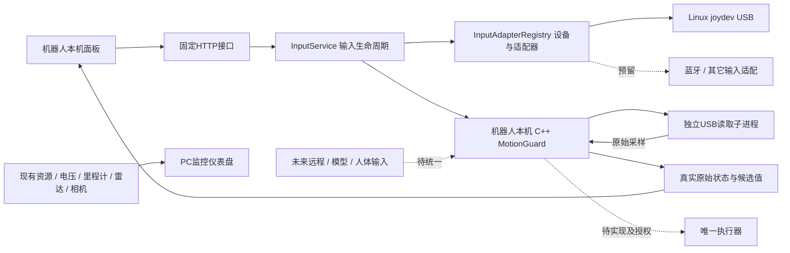

# 系统框架与扩展接口

更新：2026-11-05。这里区分已落地模块和下一阶段接口，不把预留称为已实现。

当前读取子进程先把真实采样交给持有MotionGuard的主进程；图中的连接表达模块归属。没有电机输出，远程来源尚未进入这个本地实例。

| 层 | 文件/接口 | 已有职责 |
| --- | --- | --- |
| 页面 | web/robot-panel | 弹性分页、只读状态、设备选择与刷新、面板退出；关机入口暂隐藏 |
| 应用入口 | robot/panel/server.py、start.py | 固定HTTP API、桌面启动、服务退出清理；无开机自启 |
| 输入服务 | robot/control/input_service.py | 一个受管理输入实例、显式刷新、发现/运行状态分离、停止锁存保留 |
| 设备适配 | robot/control/input_adapters.py | 枚举名称/传输/VID-PID/轴按钮；受信任适配器注册表 |
| 协议 | robot/control/input_protocol.py | 原生API2统一校验，供发布者与面板读取端复用 |
| 输入I/O | cpp/src/linux_gamepad_reader.cpp | Linux语义轴/按钮、初始化/边沿、原采样时间、私有进程/管道 |
| 安全规则 | cpp/src/motion_guard.cpp、input_mapping.cpp | 回中、使能、控制权、租约、过期与停止；本轮未改 |
| 监控 | 现有C++采集器、tools/serve_dashboard.py | 已有五路实机状态；本机面板电压汇聚仍待接 |

输入流程：枚举 → 选择兼容设备 → 明确刷新 → 停旧实例并撤销旧会话 → 重新枚举/绑定设备实例 → 新运行时未授权 → 用户物理Start。刷新不是重新授权，也不清B停止；A清除和再申请仍分开。

GET /api/input-devices只枚举并报告设备和生命周期，不启动输入。GET /api/input-observer只报告当前原生状态及250ms时效。POST /api/input-refresh经过原面板同源/令牌检查后刷新，不接受轴值或速度。UI原始值过期清空，但设备说明、最后设备和重试入口独立保留。

原生输入程序由持续存活的服务工作线程创建、读取和回收，避免HTTP请求线程结束影响父级退出保护。正常输入服务现在归面板生命周期，不再需要PC定时观测窗；面板退出会停止自己启动的原生父子进程。原有tools/observe_usb_guard.py等仍是人工诊断入口，不能和面板输入服务混跑。

新增传输/型号时，实现受信任适配器的describe/accepts/launch_arguments，注册到静态注册表；必要时扩展读取器的设备访问/规范化。保持原生采样协议和MotionGuard规则。当前仅USB joydev语义布局已实现；Bluetooth描述符implemented=false，不配对、不安装驱动。语义兼容不等于具体型号已经实测。

部署版本以源码和运行时配置共同计算标识，原生程序路径与SHA固定，避免只升级C++却复用错误的面板配置。系统不加载模型输出或用户URL作为插件代码。

下一阶段优先顺序：统一状态/能力查询和服务管理 → 统一本地/远程Command入口与仲裁 → 唯一执行器和独立停止保护 → 看护下有限运动 → 当前范围整体验收。M5设备电源移出当前计划，M6远程上线暂缓。现有手势项目、外部模型与自主修复以后都经同一权限/安全出口接入；目前未实现这些执行链。原厂固件、驱动、系统组件保持。

## M4-012：统一只读状态与能力查询

GET /api/system已接入现有loopback与Host校验，不增加POST或控制权。新文件robot/panel/system_status.py位于应用API聚合层：复用Collector缓存、InputService.status和InputObserver，不替代C++状态类型与MotionGuard。

响应按system_api_version=1版本化，包含面板instance_id、系统boot_id、查询单调时间、capabilities、services、telemetry和input。能力项分别标记implemented/available/allowed；allowed只是当前本地服务允许提出该请求，不能替代POST的同源/token检查，也不保证刷新一定成功。drive和remote_command全false；不暴露设备电源能力。

services中面板生命周期、telemetry.worker_running（线程存活）和input.process_running（原生进程存活）分开；存活不等于数据正常。遥测使用原接收时间，严格小于3000ms才返回data；保留原sampled_elapsed_ms、provider_errors。单次采样新鲜不表示每个provider成功，资源部分字段仍可能null。当前仅聚合本机系统/网络/ROS未知状态/电池Unknown，未把PC五路监控接成本机数据。

输入前后读取服务代次/PID/设备/生命周期，仅接受本服务panel_input来源且验证器认可的同一活进程状态；计入查询耗时后仍须小于250ms，失效snapshot=null。读取不扫描、不启动、不重连、不重新授权，command_usable恒false。响应是读取期间的一次观测，不是全系统原子事务或可执行指令；客户端还需计入传输/本地经过时间，不能续签原采样。

2026-11-05真实机器人初次验证：面板成功部署；连续8次系统采样新鲜，GET未启动idle输入服务。现场没有唯一兼容USB设备，未触发刷新，未验此API的有效手柄分支；保持未知值，不造输入。Python3.6语法检查通过。完整服务调度、跨来源仲裁与唯一执行器仍待实现。

## M4-013：可信进程内命令契约

新增cpp/include/amr/command_dispatcher.hpp与cpp/src/command_dispatcher.cpp，位于输入适配器和MotionGuard之间。ArmControl、MotionCommand、ReleaseControl、StopControl、ClearControl用std::variant表达互斥请求，避免一个通用结构体混放无关参数。CommandDispatcher引用原有MotionGuard，不创建第二套租约/仲裁状态；dispatch只选择对应方法、保留参数与返回结果。CommandReply.session_id仅新申请成功时非零，其余结果不续签会话。

robot_usb_guard和robot_control_gateway的控制动作均改走此契约；安全反应器的时效推进、链路状态与失败停止仍可直接调用同一个guard，不经客户端请求。调用须处于同一串行反应器，now须是该guard单调时钟。不是线程安全队列，也不鉴权；后续网络适配器必须绑定实际来源/会话、原采样引用与截止时间，不能直接反序列化后任意调用Stop/Clear/Arm。

两个程序仍各自是独立进程，不能同时接执行器，也不能声称已统一跨来源控制权。本轮没有启动文本网关、开放远程POST、接模型/ROS/电机，未修改原安全核心和输入映射。下一步将本地USB与远程命令汇入同一运行时、同一guard，再考虑唯一执行器。

2026-11-05：Jetson GCC7.5两个目标均编译通过，无警告；原核心四个文件UTF8/LF哈希与M4-011一致。编译不等于真实按键或运动验收；新路径的物理输入验证仍待设备可用。tools/build_robot_control.py只复制明确源码到独立哈希目录并构建，不运行程序。成功记录写.local/robot-control/native-build.json，安装器优先使用它，保留M4-011记录作为旧环境回退。

## M4-014：USB与私有键盘入口共用原生运行时

robot_usb_guard现在持有一个MotionGuard，串行处理USB采样与私有stdin键盘入口；独立reader子进程只采样。cpp/include/amr/keyboard_ingress.hpp与cpp/src/keyboard_ingress.cpp是输入适配层：解析固定来源请求、保留原时刻、绑定ID并转交CommandDispatcher，不替换原有核心规则。独立robot_control_gateway仍仅诊断，未启动，不能另接执行器。

InputService的持久工作线程创建stdin=PIPE并持有写端，传--keyboard-stdin。send_keyboard是可信项目内方法，尚无HTTP/远程/网页入口；其返回enqueued只表示写入管道，不是安全层接受或电机执行。写入前绑定服务generation与guard boot，非阻塞单次原子写，不重试或重打时间戳。退出/刷新关闭自有stdin和原生父子进程。旧版本启动器和不可变构建目录保留。

私有线格式：boot sequence sampled_monotonic_ms action [session forward backward left right deadman]。arm/stop无尾参数；release仅session；keys为session加五个0/1。boot与session是十进制uint64；同一Linux主机CLOCK_MONOTONIC原采样时刻，不接受PC/浏览器墙钟。键盘固定controller2/Keyboard，USB固定controller1/Gamepad，不能由消息选择来源。键盘只接受arm/keys/release/stop；不能clear或修改链路。先申请，再收到授权后用真实回中输入确认，之后才接受使能命令。

读取每tick最多256字节，单行最多160；时间窗严格小于250ms，序号递增、时钟不倒退，命令不超原采样截止。转换使用进程起点毫秒向上取整，最多缩短1ms。控制会话变化或本地Start/Back/B/A动作会阻断动作之前排队的请求；租约规则仍来自原MotionGuard。无效格式或管道EOF终止键盘通道并释放它自己持有的Keyboard会话，不撤销Gamepad控制权；软件stop仍停止所有来源。通道不能自动恢复，要显式刷新。

本轮采取保守故障边界：USB读错/拔线/超时结束整个输入运行时，不自动转键盘，不在无USB时启动独立远程控制。尚未实现无需USB的公共网关模式，也未开放真实运动。control_owner和keyboard_channel_open/sequence/result是原生API2可选诊断扩展；USB源时效仍不代表键盘命令有效，后者由同一个guard检查。

2026-11-05实机：GCC7.5双目标构建通过；安装新版后显式刷新真实USB成功，连续8次有效输入（约11–30ms），同一进程实例，keyboard_channel_open=true，keyboard_sequence=0，未授权且候选零。补验了M4-012的有效输入聚合分支。没有发送模拟键盘命令；真实双来源争用/断管/旧包分支和执行器仍待验。核心四文件哈希保持M4-011原值。

## M4-015：本机键盘候选页与受控入口（2026-11-07）

新增robot/panel/keyboard_controller.py位于HTTP应用层，管理独占页面租约与时间票据，不实现运动规则。GET /api/keyboard只读状态并生成无控制权限的1000ms时钟票据；POST复用精确Host/Origin/CSRF、去重JSON字段与512字节上限。open只创建30秒页面会话，不申请原生控制；其余动作绑定页面token、递增序号、原生generation/boot。键盘候选仍经原有管道和同一个MotionGuard。

前端记录票据响应时的performance时基，在真实事件/采样时冻结elapsed，后端换算原生主机单调采样时间，仍须小于250ms；不累计重试旧帧。clock ticket引用寿命和采样有效期不同。来源改变或失效撤销页面会话；close可使用过期/空票据，属于当前撤销事件，不重打旧速度时间。HTTP202仅入管道，实际owner/armed/neutral/candidate来自原生状态。

独立页keyboard-control.mjs注册在面板后组，支持真实WASD/方向、Space和pointer捕获触摸按钮。明确取得会话→申请控制权→原始回中确认→重新按下使能；旧按住态不自动激活。失焦/隐藏/离页清空意图并尽力close，无自动重开/重授。停止/释放先于close串行提交；原安全请求过期丢弃并说明未确认，不能由close抢先。只有实体USB A可清停止。晚open响应取得的token亦要补close。

实际核验：Python3.6/JS语法通过；机器人部署并刷新真实USB成功，8条有效输入；缺Origin、错CSRF、非法clear、重复字段、超长体、伪页面token均被真实接口拒绝，原生键盘序号0未变化。两尺寸1024x600/800x480无整页溢出，关机隐藏、退出保留、只读导航无控制POST。PC经两段SSH访问时状态请求出现180ms超时，截图显示无新鲜状态；该检查仅证明布局/失败关闭，未证明本机交互稳定或双来源控制通过。需在机器人本机页面进行真实操作验收。没有合成键盘/手柄输入，没有电机/关机操作。

## M4-016：指令回执与最近结果（2026-11-07）

新增robot/control/command_history.py，是输入服务适配层的有界内存历史，不替换原C++ EventLog和MotionGuard。HTTP入管道与原生守卫结果分开记录；回执按(generation,boot_id,request_sequence)严格等值关联，不用较新序号替代旧请求。原生KeyboardIngress保存最近16个回执（独立递增receipt id、原请求序号、原生时间、结果），以API2可选keyboard_receipts数组发布；拒绝时也保留可解析的原请求序号，不冒用上一次请求。

InputService在持有同一生命周期RLock时注册enqueued和消费原生回执，避免回执早于登记。receipt id缺口明示receipt_gap；超过500ms仍未确认、来源结束/刷新或pending容量不足时只标unconfirmed，不推断拒绝或成功。晚回执可保留独立native_result/unmatched证据，不能假配对其它请求；新代次只终结其它代次pending。guard_state单独记录真实owner/session/停止原因变化，不当作请求确认。

历史最多200条、pending最多64项，GET /api/control-events只返回最近20条及丢弃计数；重启清空、不落盘，不记录token、原始轴键或完整样本。HTTP GET沿用本机Host检查，不启动或刷新输入、不授予控制。键盘页追加“最近指令结果”折叠区，500ms独立读取，失败不污染当前候选；这属于正常功能历史，不是人工验证录制窗口。

实际核验：Jetson GCC7.5两目标编译通过，原安全/映射四文件哈希保持；部署后真实USB8次有效采样，原生keyboard_sequence=0/receipts为空，查询未切换运行时。读取到启动时LinkUnavailable→Disarmed两条真实guard_state；两尺寸展开历史均显示2行、无整页溢出，控制POST/关机POST均为0。没有发送键盘请求，不将该证据解释为请求回执、丢失/超时/容量边界或双来源仲裁验收通过。人工验证断点继续保留，无执行器。

## M4-017：开发优先的集成代码（2026-11-07，全部待验证）

按用户最新决定本轮只写代码，无编译、测试、语法检查、部署或实机读数。旧实机版本不变，以下不能表述成已可用。

- single_executor.hpp/cpp：唯一输出拥有者接口与独立20ms循环，保留guard原始命令/租约截止，时钟/限速/输出失败进入故障且不自动恢复；默认禁用，不启动输出线程。当前USB反应器只接禁用对象，无运动启用路由。
- ros_velocity_sink.hpp与cpp/ros/velocity_sink.cpp：可选ROS1原厂/cmd_vel适配库，当前用户项目flock、精确厂商订阅节点、无其它发布者、250ms graph许可。库构建默认OFF，未挂接真实输出；只凭publish不能确认运动/停车。
- project_services.py与project-services.mjs：固定input/telemetry/camera三类项目服务启停，互斥操作；executor只显示disabled。停止输入保留B锁存，重新启动不授权。不得管理原厂/系统服务。
- telemetry_service.py与owned_source_runner.py：独立持久父线程拥有各只读采集进程，父退出保护、路径/哈希/用户权限约束、原有StateBuffer/CameraBuffer校验复用；采用启动前时间锚的保守传输滞后，不给积压帧续鲜。电池概览另计源样本年龄。
- robot/panel/server.py：完整/dashboard静态白名单及相对资源、API state/camera接入统一来源，图片CSP允许data图像。无源配置仍Unknown/disabled，不生成假样本。
- tools/serve_robot_console.py：手动PC/手机内网访问，默认只读、明确IPv4/TLS/访问口令/Cookie与精确来源检查；仅固定URL白名单，控制须显式参数，关机永远禁止转发，不重发失败请求。不是M6公网部署或自动SSH。
- 配置模板、启动草案、集中验收清单已写；实际二进制哈希、厂商节点名、LAN证书和网络实况在最后阶段核实。ROS真实输出启用接线仍需最终明确授权，不能在此阶段悄然打开。

原有C++核心/学习Note未改；所有运行行为和兼容性均待最终集中验收。

## M4-018：当前范围代码收尾（2026-11-07，仍未验证）

显式输出接线补齐：默认API2关闭；私有execution_profile校验本机boot/Native SHA/人工确认/到期≤300秒/订阅节点，持久线程启动时才读取并传给可选ROS构建。Native仍未授权，真实速度必须经原MotionGuard回中/使能/租约；短期输出许可和命令截止两者取更短者。ROS graph续期不清空尚有效旧许可，慢查询不能延长其有效期；失效/冲突结束输出，无自动恢复。

正常面板只接受固定私有授权路径，网页不能创建/续期；本机直接运行原生开发CLI同属操作者责任，不作为HTTP授权入口。授权工具、撤销监测和手动刷新流程已写，未调用，没有创建真实授权。

Native API3报告真实执行状态；InputService和只读Observer按私有marker绑定允许，API2仍拒绝任何执行器。GET keyboard/system/services与本机概览传回真实模式，失去新鲜采样保留保守警示，不把未知当作输出已关闭。完整仪表盘新增独立系统模式提示，采集器自身motion_enabled=false不能证明整机输出关闭。

PC访问材料生成/保存配置启动工具、固定白名单转发、无真实输出旧版本回退工具已写。所有这些是源码交付，未编译/测试/部署；旧实机仍是M4-016，不得将旧证据迁移给新源码。当前开发范围代码已收尾，余下是按FINAL_ACCEPTANCE集中构建、现场配置、验收和缺陷修正；蓝牙/M5电源/M6公网和长期具身目标不纳入本次完成声明。

## M4-019：集中集成检查与默认关闭输出的交付（2026-11-07）

M4-017/018的代码阶段已经结束。双平台/两种原生构建、真实资源/相机采集、服务启停、HTTPS只读代理、真实网页图片和桌面入口回退已经执行，修正来源权限、解码依赖、CSP、证书配置及相机持续生命周期。当前发布06d39ffa22ca0506，不再是上文代码阶段的旧部署。精确结果和边界见 FINAL_INTEGRATION_REPORT.md。

没有生成真实输出授权；正常入口保持API2，USB只是实际输入/安全层观测。M7仍需用户现场双来源、真实手机、原厂节点五路及看护下移动验收；不得把本轮构建/采集结果扩展为物理安全证明。
